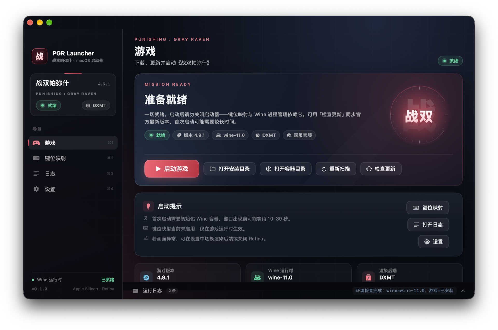
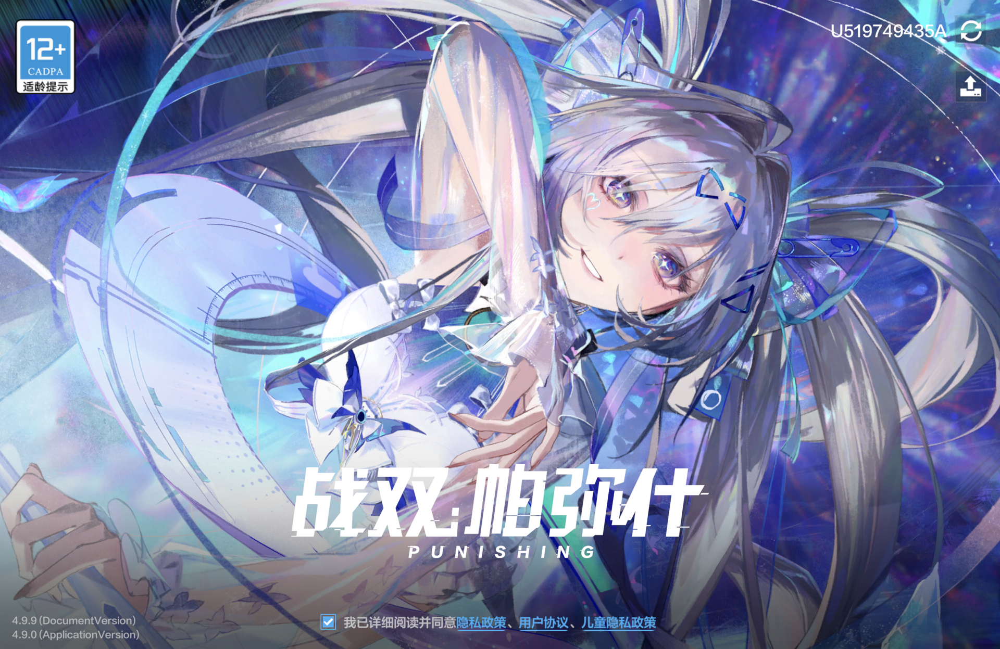

# PGR Launcher · 战双帕弥什 macOS 启动器

> 一个类似 [Yaagl](https://github.com/yaagl/yet-another-anime-game-launcher) HSR 启动器的 macOS 原生 App：
> 在 Apple Silicon Mac 上下载 / 更新 **Windows 版《战双帕弥什》**（Punishing: Gray Raven），
> 并在 Wine 容器中运行，支持 **Retina 高清渲染** 与 **键盘映射**。

本项目是社区爱好者作品，与库洛游戏 / Kuro Games 无关。

## ✨ 功能

- **一站式环境准备**：自动下载并校验 Wine 11（Crossover 内核）+ DXMT（D3D11 → Metal 翻译层），创建独立 Wine 容器，无需手动装 Homebrew / Whisky / CrossOver。
- **游戏下载 / 更新（Yaagl 式 CDN 直连）**：直接对接官方 CDN 下载游戏文件（国服官服约 68.8GB / 国际服约 68.4GB，85,000+ 文件），逐文件 MD5 校验、并发下载、断点续传，更新时只下载变更文件；不依赖官方 Windows 启动器（其在 Wine 下不可用）。
- **多渠道支持**：国服官服（G148/10012）、国服 B 服（G148/10011）与国际服（G143/50015）配置端点内置，可切换；支持自定义配置地址。
  **国服官服/B 服无内核反作弊（无 ACE）**，是本启动器推荐渠道；国际服带腾讯 ACE，Wine 兼容性风险高。
- **ACE / Rosetta 兼容运行时**：在 Wine 11 基础上叠加 FineWine（CrossOver 26.3 + DW-Proton 补丁）模块，修复 Apple Silicon 下 `PGRBase.dll` 的 Rosetta 崩溃，并让内核态驱动初始化流程在 Wine 中可用。
- **Retina 高分辨率渲染**：按用户设置写入 Wine `RetinaMode`，在 Liquid Retina XDR 屏幕上以原生分辨率渲染（可随时关闭）。
- **键盘映射**：基于 CGEventTap 的全局键位重映射（游戏运行期间生效，退出即停止），支持逐条映射、开关与“按键录入”式配置。
- **Yaagl 风格界面**：深色游戏启动器 UI，主界面 / 设置 / 键位映射 / 实时日志，全中文。
- **配置隔离**：所有运行时、容器、日志、配置都收在 `~/Library/Application Support/PGRLauncher`，游戏默认安装在 `~/Games/PGR`，卸载即清理。
- **实测状态**：Wine 运行时（含 FineWine/DXMT）可通过 App 一键安装成功；国服官服客户端在 Wine 下已验证可加载 `PGRBase.dll` → `UnityPlayer.dll` → `GameAssembly.dll` → Unity/IL2CPP 初始化（详见 `docs/WINE-RUNTIME.md`）。

## ✅ 本机实测结果（2026-11-09 / 27.3 / Apple M6）

| 项目 | 结果 |
|---|---|
| Wine 运行时一键安装 | ✅ 456MB Wine + 4.1MB FineWine + 17.8MB DXMT，镜像加速后约 1 分钟下载，SHA-256 全部校验，prefix 初始化成功 |
| 国服全量下载 | ✅ 85,254 文件 / 68.75GB，官方 CDN 直连，实测峰值 ~120MB/s（8 并发大文件），小文件通道 32 并发 |
| 断点/续传/校验 | ✅ 二次 install 全量校验 27s、空计划直接通过并写完成标记；MD5 全量一致 |
| 游戏启动 | ✅ `PGR.exe` 经 PGRBase → UnityPlayer → IL2CPP → **DXMT(D3D11→Metal)** 正常启动，进入 **KURO GAMES 登录界面**（手机号+验证码/扫码登录），可交互 |
| 字体/编码 | ✅ 修复：启动 env 强制 `LANG/LC_ALL=zh_CN.UTF-8`，避免 Wine 按 C locale 映射 codepage 1252 造成游戏内部分中文乱码 |
| 分辨率/清晰度 | ✅ 修复：Retina 模式在启动前同步应用（原先异步写入存在竞态，游戏拿到 1512×982 逻辑分辨率被 2× 放大发糊）；现原生 3024×1964 |
| Retina / 清晰度 | ✅ 启动前**同步**写入 `RetinaMode=y`（并等待 wineserver 落盘），游戏原生渲染 **3024×1964**（实测日志 `unity写入的设备分辨率 3024 * 1964`），不再被 macOS 2× 放大发糊；设置中可开关（关闭可提升性能） |
| 键位映射 | ✅ CGEventTap 实现，游戏运行时生效、退出自动停止；需辅助功能授权 |

截图：

| | |
|---|---|
|  |  |
| 启动器（就绪状态，版本 4.9.1） | 游戏登录界面（国服，DXMT 渲染） |

> 说明：本机已把国服客户端完整安装到 `~/Games/PGR` 并验证可启动；打开 App 即可直接「启动游戏」。
> 国际服（G143）带腾讯 ACE 内核反作弊，Wine 兼容性风险高，未做全量验证，见 `docs/WINE-RUNTIME.md` §5.5。

## 🖥 环境要求

- macOS 14+（推荐 macOS 15 / 26 / 27），Apple Silicon（M 系列）
- 约 2GB 可用空间（Wine 运行时 + DXMT + 安装器缓存）；游戏本体另需约 20GB+
- 首次运行需要联网；键盘映射需要在「系统设置 → 隐私与安全性 → 辅助功能」中授权

## 🚀 快速开始

```bash
# 1. 构建
./scripts/build.sh          # 产物 build/PGRLauncher.app（release 优化构建）

# 2. 运行
open build/PGRLauncher.app
# 或调试模式（终端可见日志）
./scripts/build.sh debug && build/PGRLauncher.app/Contents/MacOS/PGRLauncher
```

首次进入 App 后按引导：

1. 点击 **准备 Wine 环境**：下载 Wine 11 + DXMT（约 480MB，内置 GitHub 镜像加速与 SHA-256 校验），初始化 Wine 容器（约 1–2 分钟）。
2. 在设置里选择 **游戏服务器**（国服官服 / 国际服）。
3. 点击 **下载游戏**：直接从官方 CDN 下载全部游戏文件（约 68GB，可断点续传，逐文件 MD5 校验；耗时取决于网络）。下载完成后按钮变为 **启动游戏**。
4. 后续版本更新：点击 **检查更新**，只下载变更文件。
5. 首次启动前可能需要登录/更新启动器组件：游戏会在首次运行时拉取登录器（若遇到问题请查看日志）。

> 提示：把 `build/PGRLauncher.app` 拖到 `/Applications` 后使用体验更佳（首次打开如提示“无法验证开发者”，
> 在「系统设置 → 隐私与安全性」中点击“仍要打开”即可；本项目为 ad-hoc 签名，未做 Apple 公证）。

## ⚙️ 设置说明

| 设置 | 说明 |
|---|---|
| 渲染后端 | 默认 **DXMT**（D3D11/D3D10 → Metal，轻量、适配好）；D3DMetal 为预留项 |
| Retina 模式 | 写入 `HKCU\Software\Wine\Mac Driver\RetinaMode`，在 Retina 屏以高分辨率渲染 |
| 帧率上限 | 传给 DXMT 的 `d3d11.preferredMaxFrameRate`（0 表示不限制） |
| Metal HUD | 叠加显示 Metal 性能 HUD，便于观察 GPU 负载 |
| 代理 | 供 Wine 进程与下载器使用的 HTTP(S) 代理 |
| 游戏服务器 | 国服官服 / 国际服（各自独立账号与 CDN） |
| 游戏目录 | 默认 `~/Games/PGR`，可改到任意位置（不要放在 `/Applications` 内） |
| 自定义 CDN 配置地址 | 可选；留空则使用所选渠道的官方配置端点 |

## 🗂 数据目录

```
~/Library/Application Support/PGRLauncher/
├── Runtime/wine/       # Wine 发行版（wine/bin/wine）
├── Runtime/downloads/  # 运行时/缓存归档
├── CDN/cache/          # 游戏版本清单（indexFile.json）缓存
├── Bottle/             # WINEPREFIX（C: 盘）
├── logs/               # 启动器 / Wine / DXMT 日志（界面里可直接打开）
└── config.json         # 用户配置

~/Games/PGR/            # 游戏安装目录（可在设置中修改）
```

完全卸载：删除 PGR Launcher.app 与上述两个目录即可。

## 🏗 技术栈

- **Swift 6 / SwiftUI / AppKit**，无第三方依赖，`swiftc` 直接构建 `.app`
- **Wine 11（Crossover 内核，x86_64 + Rosetta）** + **DXMT**（Metal D3D11）
- **URLSession** 断点续传下载、**CryptoKit** SHA-256 校验
- **CGEventTap** 键盘重映射、**AXIsProcessTrusted** 辅助功能授权
- 详细设计见 [docs/ARCHITECTURE.md](docs/ARCHITECTURE.md)

## ❓ 常见问题

- **启动器界面显示“需要准备 Wine 环境”**：正常，首次使用请先点击准备环境。
- **下载 Wine 很慢**：内置 `gh-proxy.com` / `ghfast.top` 镜像回退；仍慢可配置代理后重试。
- **游戏无法启动 / 黑屏**：查看界面日志（`~/Library/Application Support/PGRLauncher/logs/`），
  尝试关闭 Retina、降低帧率上限、切换渲染后端。注意：战双 PC 客户端带腾讯 ACE 反作弊（内核驱动），
  Wine 兼容性受 ACE 版本影响；详见 `docs/WINE-RUNTIME.md`。
- **键盘映射无效**：确认已在「辅助功能」中授权，并确认总开关打开、游戏正在运行。
- **官方启动器提示更新失败**：多与网络/区域有关，可尝试代理；官方启动器逻辑由其自身负责。

## ⚠️ 免责声明

- 本项目不提供、不分发游戏本体或任何破解内容，仅作为 Wine 容器与官方启动器的图形化外壳。
- 使用本项目可能违反游戏服务条款，存在账号风险，请自行评估。
- Wine / DXMT / 相关补丁版权归各自作者所有。

## 🙏 致谢

- [Yaagl](https://github.com/yaagl/yet-another-anime-game-launcher) — 设计参考与 Wine 发行版
- [DXMT](https://github.com/3Shain/dxmt) — D3D11 → Metal
- [Wine](https://www.winehq.org/) / [CrossOver](https://www.codeweavers.com/)
- [Lutris](https://lutris.net/) 社区的战双 Wine 安装脚本（官方启动器方案的可行性依据）
